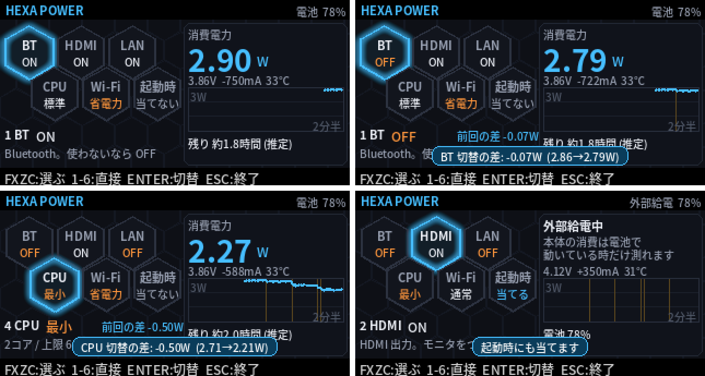

# HEXA POWER v0.1

CardputerZero 用。消費電力を見ながら、電気を食う機能を ON/OFF するアプリ。
ﾊﾆｶﾑの画面は HEXA CLIP と同じ流儀 (強調色は青)。



## はじめる
```sh
cd ~/hexapower && sh install.sh     # sudo は付けない
sudo reboot                         # 初回だけ (ｱｲｺﾝと権限の反映)
```
ﾗﾝﾁｬｰの「HEXA POWER」から起動。ｺﾏﾝﾄﾞなら `hexapower`。

## 画面
左に六角形が6つ、右に今の消費電力 (W) と 2分半のｸﾞﾗﾌ。

| ｷｰ | 項目 | ENTER で |
|---|---|---|
| 1 | BT | Bluetooth ON/OFF (rfkill) |
| 2 | HDMI | HDMI 出力 ON/OFF |
| 3 | LAN | 有線LANﾁｯﾌﾟ(USBの SR9900) を切り離す/戻す |
| 4 | CPU | 標準 → ｴｺ(2ｺｱ) → 最小(2ｺｱ・最低ｸﾛｯｸ) |
| 5 | Wi-Fi | Wi-Fi の省電力 ON/OFF |
| 6 | 起動時 | ここでの設定を次の起動時にも当てる |

- ｵﾚﾝｼﾞ色 = 節電している状態
- 切り替えると約15秒後に **切替前との差 (W)** が出る。六角形の下にも「前回の差」が残る
- 方向キー F/X/Z/C、1〜6で直接、R で状態を取り直す、ESC で終了 (設定はそのまま残る)

## 測れる条件
消費は残量計 BQ27220 (I2C 0x55) から読む。**USB / EXT から給電中は本体は外の電気で動く**ので、電池側から消費は測れない (画面に「外部給電中」と出る)。測る時はｹｰﾌﾞﾙを抜く。

## 仕組み
- `hexapower.py` … 画面 (一般ﾕｰｻﾞｰで動く。video/input/i2c ｸﾞﾙｰﾌﾟ)
- `/usr/local/sbin/hexapower-ctl` … 設定の書き換えだけする root のﾍﾙﾊﾟｰ。sudoers でこれだけﾊﾟｽﾜｰﾄﾞなし (`/etc/sudoers.d/hexapower`)
- `hexapower.service` … 起動15秒後に `hexapower-ctl apply-boot` (「起動時」が ON の時だけ当てる)
- 保存先: `/etc/hexapower.json`
- 電池の値は `/sys/class/power_supply` に残量計があればそこから、無ければ I2C で直接

## 困った時
- `hexapower --probe` … 電池の読み方・値、各機能が見つかるかを表示
- 画面が戻らない: `sudo pkill -CONT -f APPLaunch`
- 全部元に戻す: アプリで各項目を ON / 標準 にする、または
  `sudo hexapower-ctl set bt on; sudo hexapower-ctl set lan on; sudo hexapower-ctl set cpu std; sudo hexapower-ctl set hdmi on; sudo hexapower-ctl boot off`
- 有線LANで SSH している時に LAN を OFF にすると切れる (Wi-Fi なら大丈夫)

## 実機で確かめること (v0.1 は PC の模擬でだけ確認)
- 電池の値がどちらで読めるか (`--probe`)、電流の符号 (放電がﾏｲﾅｽになるか)
- HDMI が `/sys/class/drm/card*-HDMI-A-*` で切れるか (無ければ vcgencmd)
- LAN の切り離しで本当に下がるか (USBﾊﾌﾞのﾎﾟｰﾄ電源は切れないので、ﾁｯﾌﾟが休むだけ)
- 本体ﾌｫﾝﾄ(AlibabaPuHuiTi)で字が□にならないか (`hexapower --check-font`)
